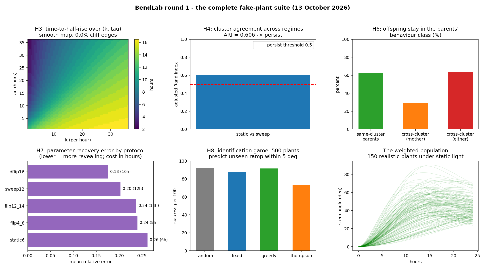
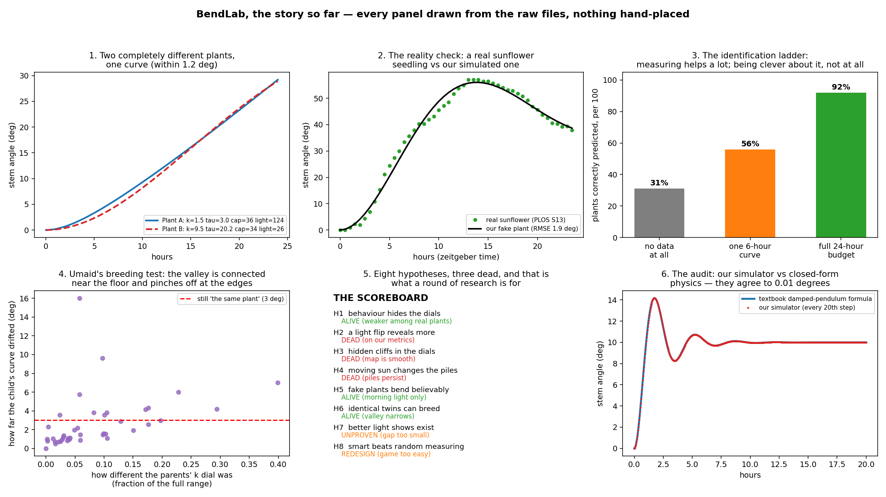

# BendLab

**Simulating and clustering plant responses to light**

A plant bends toward light. Two plants can bend in what looks like the same
way and still be built differently underneath. BendLab generates large
populations of simulated bending plants, measures how each one responds to
light, and asks which differences in the underlying parameters are actually
visible from the outside.

Round 1 is complete: eight hypotheses tested, three falsified, one
unanswerable as specified, three surviving.
[`docs/RESULTS_ROUND0.md`](docs/RESULTS_ROUND0.md) and
[`docs/RESULTS_ROUND1.md`](docs/RESULTS_ROUND1.md). Dashboard below.





## The question, plainly

A bending-stem model has four parameters: how strongly the plant responds to
light (`k`), how long it takes to react (`tau`), the fastest it can bend
(`max_rate`), and where the light is (`phi0`). We simulate 10,000 plants with
random parameters, record the angle of each stem over 24 hours, then cluster
the plants by behaviour.

The finding so far: a cluster of plants that look alike still contains nearly
the full range of every parameter. **Behaviour does not identify the plant.**
That is the result, not a failure to find one.

## What is in here

| Path | What it is |
|---|---|
| `PROBLEM_STATEMENT.md` | the question, the model, and hypotheses H1-H5 with falsification criteria, written before any experiment ran |
| `sim.py` | the simulator. Two-state model with a sensing lag and a saturating bend rate |
| `features.py` | feature extraction, defined before results existed so it cannot be tuned to flatter them |
| `generate_plants.py` | seeded parameter sampler, uniform population and the disjoint split rule |
| `data_real.py` | reader for the real stem-angle data |
| `fit_real.py` | H5: fit the model to real sunflower curves, plus two degeneracy probes |
| `sweep.py` | H1/H2: run a population under static light and under a mid-run flip, cluster on behaviour |
| `docs/DATA_SOURCES.md` | where plant data comes from, tiered by how usable it is |
| `docs/DATA_CONTRACT.md` | every sheet, its units, sampling rate, and the parsing rules |
| `docs/EXPLAINER.md` | the project in plain words, part 1 |
| `docs/EXPLAINER_PART2.md` | plain words, part 2: the round-1 suite and the audit |
| `docs/RESULTS_ROUND0.md` | round 0 results, caveats and next steps |
| `docs/RESULTS_ROUND1.md` | round 1 results (H3-H8), the audit, and why it runs in seconds |
| `docs/IDENT_GAME.md` | the round-2 design: the adaptive identification game |
| `sweep_weighted.py` | the same sweep with plants drawn from the fitted region |
| `round1.py` | H3, H4, H6, H7, H8 in one run, all thresholds declared at the top |
| `audit_round1.py` | independent re-derivation of every finding, prints ALL CHECKS PASSED |
| `make_explainer_figures.py` | builds the six-panel explainer figure from the raw files |
| `data/real/` | the real dataset, see attribution below |
| `results/` | CSV outputs of the runs, committed so the write-up is checkable |

## Reproduce

Python 3.10 or later. Install, then run from the repository root, because the
data paths are relative to it.

```bash
pip install -r requirements.txt
python generate_plants.py     # sanity check the generator
python fit_real.py            # H5 fit, ~1 minute, writes results/fit_fig1c.csv
python sweep.py               # 10k plants x 2 regimes, ~5 seconds
python sweep_weighted.py      # same sweep, plants drawn from the fitted region
python round1.py              # H3, H4, H6, H7, H8 + dashboard, ~15 seconds
python audit_round1.py        # independent re-derivation of every finding
python make_explainer_figures.py   # rebuilds the explainer figure
```

Run in that order: `fit_real.py` writes the fits that the weighted
population and the round-1 suite are built from.

Both scripts are seeded from declared integers. No wall-clock, no unseeded
draws in the simulation path, so a rerun is bit-identical. `sweep.py` and
`fit_real.py` create `results/` if it is missing.

## Headline numbers, round 0

**H5, the reality anchor.** Median per-plant RMSE against 48 real sunflower
curves is 4.74 degrees. Median across-plant standard deviation in the same
data is 8.58 degrees. The model is wrong by less than real plants differ from
each other, in all six light treatments. 20 of 48 fits end with `tau` pinned
at its bound, all in the ZT12 and ZT16 blocks: the static-light assumption
fails for midday and afternoon treatments, so only the 28 clean fits define
the plausible region.

**H1, degeneracy.** After clustering 10,000 simulated plants into six
behavioural groups, a group still retains 25 to 50 per cent of the full
parameter range. The largest group, 2,859 plants, spans essentially the
entire box for `k`, `phi0` and `max_rate` while its members are
behaviourally near-identical.

**Degeneracy weakens where real plants live.** Repeating the sweep with
plants drawn from the fitted region instead of the uniform box drops
retention on every parameter: k 25 to 13 per cent, tau 36 to 10, phi0 25 to
8. It also flips the speed limit from inert to meaningful: the cap binds for
1 plant in 2,000 under uniform sampling and 7.19 per cent under weighted.

**Exact degeneracy, on real data.** Refitting plant ZT0-1 with the rate cap
removed gives RMSE 1.894 against 1.894 with the cap fitted. Identical, because
the realised rate never reaches the cap. `max_rate` is not hard to recover
from that curve, it is unrecoverable.

**H2, not supported yet.** A 45 degree light flip at hour 8 does not tighten
parameter recovery on the cluster-retention metric. The metric is probably the
weak part, not the hypothesis.

## Scope, stated so nobody oversells it

This is a model study. Every result describes the simulator, not real plants,
except in `fit_real.py` where measured data is used explicitly and named. The
toy model is not a functional-structural plant model, not a crop-yield tool,
and not evidence about any real species. The gap between the two is exactly
what H5 measures and nothing more.

## Data and attribution

Real stem-angle data: **S13 Data** from *Multiple light signaling pathways
control solar tracking in sunflowers*, PLOS Biology 2023,
[doi 10.1371/journal.pbio.3002344](https://doi.org/10.1371/journal.pbio.3002344).
PLOS Biology publishes under CC BY, so the file is included here with
attribution. Downloaded 11 October 2026, 67,115 bytes, SHA-256
`1257f4069f4fb600d0bddb616110772af28552dc43ad330c18aa3dea58a590b7`.

The model form descends from classical phototropism work: the Cholodny-Went
theory of tropic curvature and the Blaauw sine law for first positive
phototropism. See `docs/DATA_SOURCES.md` for the full reading list.

## How we work

Hypotheses and falsification criteria are written before the experiment that
tests them. A hypothesis that fails is abandoned, not reworded. Negative
results get reported with the same prominence as positive ones. Baselines are
reproduced before anything new is claimed. Bugs found in our own code are
written down with the numbers they affected.

## Authors

- Anadi Tripathi — [@Yash-Tripath1](https://github.com/Yash-Tripath1)
- Umaid

AI tools used: Arena.ai Agent Mode for ideation, code, debugging and drafting.
All data sources, licences and checksums are recorded above and in `docs/`.

## Licence

Code: MIT, see [LICENSE](LICENSE). Data in `data/real/` remains under the
PLOS CC BY terms of the source article.
