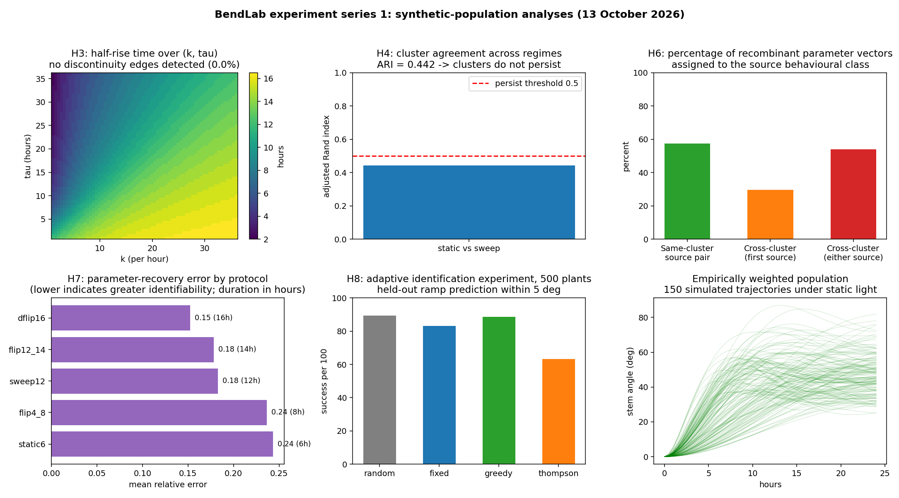
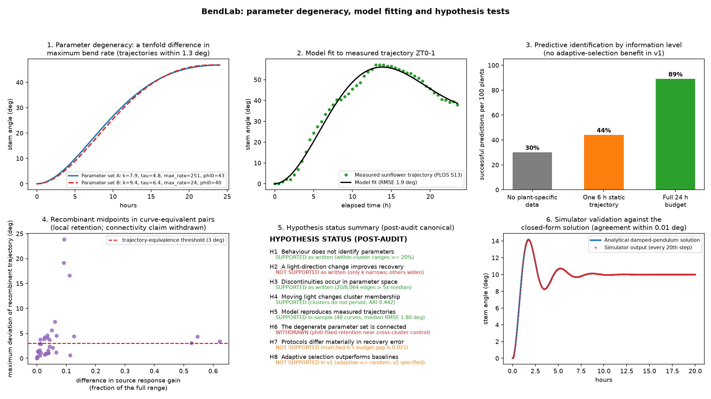
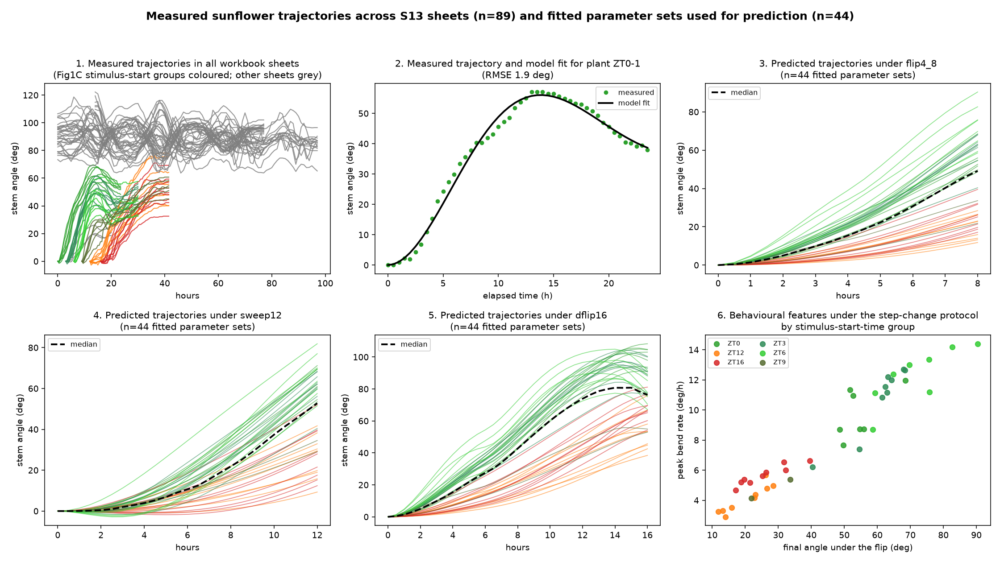

# BendLab

**Parameter identifiability in a minimal model of phototropic stem bending**

BendLab examines whether the parameters of a four-parameter bending model
can be inferred from observed stem-angle trajectories. The project combines
a mechanistic simulator, behavioural clustering, parameter-degeneracy
analysis, fits to published sunflower data, and pre-specified comparisons
of light protocols and adaptive protocol-selection policies.

Experiment series 1, the external audit follow-up, Phase B0 external
benchmarking and stem-shape audit, and the growth-aware phototropism
study (Phases A–C) are complete. Across the eight original hypotheses
(H1–H8), four are supported with stated qualifications (H1, H3, H4, and
H5 in-sample), three are not supported as specified (H2, H7, and H8 in
v1), and one global connectivity claim (H6) was withdrawn following
external audit (`docs/AUDIT_FOLLOWUP_RESULTS.md`). Subsequent Phase B0
and growth-phase packages evaluate out-of-sample generalisation on 268
independent unilateral trajectories (Kempinski et al. 2026), a
multi-segment curvature extension, and hypocotyl-length coupling across
213 paired seedlings; see `docs/CURRENT_STATUS.md` for the canonical
summary.

## Principal findings

- Behaviourally similar simulated plants can retain 25–50 per cent of
  the full range of each model parameter; observed behaviour therefore
  does not uniquely identify the underlying parameters.
- The maximum bend rate (`max_rate`) is exactly unidentifiable for
  trajectories that never reach that rate limit (47 of 48 measured
  `Fig1C` curves; ~44 per cent held-out neural-inverse error at every
  observation window).
- The model fits 48 measured sunflower trajectories (`Fig1C`) in-sample
  with a median per-plant RMSE of 1.80 degrees against 8.58 degrees
  across-plant spread, but generalises weakly across held-out
  stimulus-onset blocks (LOBO median RMSE 11.75 degrees); a shared
  circadian-gating candidate (`sim_clock_gamma.py`) improves all six
  held-out ZT9 curves (median RMSE 2.42 to 1.44 degrees).
- On an independent external dataset of 268 unilateral phototropism
  trajectories across 10 light intensities (0.7–5.8 W/m², Kempinski et
  al. 2026), fixing `phi0 = 90` degrees to physical lamp geometry
  overshoots (14.41 degrees held-out median RMSE vs 9.73 degrees
  group-mean baseline) because `phi0` in the minimal scalar model acts
  as an effective equilibrium angle (~52 degrees); fitting a shared
  equilibrium angle lowers held-out median RMSE to 9.65 degrees.
- Observing full multi-segment stem curvature (`sim_multiseg.py`)
  reduces `k` twin-lookup error by 33–49 per cent under leakage-safe
  splits while leaving `max_rate` unidentifiable; pairing starting
  hypocotyl length `L0` across 213 seedlings reveals a +2.12 deg/h per
  log-length early-rate association (p = 0.0022) without improving
  held-out ODE trajectory RMSE over length-blind M0 (10.25 degrees).
- Behavioural clusters are protocol-dependent (adjusted Rand index
  0.442 < 0.50 between static and moving light), and adaptive protocol
  selection did not outperform random selection under the corrected v1
  design.







## Research question

The model contains four parameters: response gain (`k`), sensing lag
(`tau`), maximum bend rate (`max_rate`) and light direction (`phi0`).
BendLab generates populations of simulated plants with known parameter
values, records stem angle over time, and asks which aspects of those
parameters can be recovered from behaviour alone.

The current results indicate that a behavioural cluster can contain
nearly the full range of every parameter. This discrepancy between
behavioural similarity and parameter similarity is the project's central
result.

## Repository contents

| Path | Description |
|---|---|
| `PROBLEM_STATEMENT.md` | Research question, model specification and hypotheses H1–H8 with falsification criteria |
| `sim.py` | Two-state simulator incorporating sensing lag and a saturating bend rate |
| `features.py` | Behavioural feature extraction, specified independently of fitted outcomes |
| `generate_plants.py` | Seeded parameter sampling for uniform and empirically weighted populations |
| `data_real.py` | Reader for the measured stem-angle dataset |
| `fit_real.py` | H5 model fitting to measured sunflower trajectories and parameter-degeneracy probes |
| `sweep.py` | H1/H2 population simulations under static and stepped light regimes |
| `sweep_weighted.py` | Population simulations using the parameter region derived from measured-data fits |
| `round1.py` | H3, H4, H6, H7 and H8 analyses, with thresholds declared in the source file |
| `audit_round1.py` | Independent re-derivation and analytical checks of the principal results |
| `make_explainer_figures.py` | Construction of the six-panel results summary figure |
| `real_seedling_sim.py` | Simulations of measured-data parameter sets under alternative light protocols |
| `zt9_diagnostics.py` | Residual, lag-bound sensitivity and stall-timing analyses for the ZT9 model limitation |
| `sim_gamma.py` | Model v2 candidate A: simulator with a proprioceptive (autostraightening) term |
| `sim_clock_gamma.py` | Model v2 candidate B: simulator with circadian gating of sensitivity, optionally combined with the proprioceptive term |
| `gamma_zt9_test.py` | Evaluation of the proprioceptive candidate on ZT9-1 (negative result) |
| `clock_validation.py` | In-sample reproduction and shared-clock held-out evaluation of the circadian-gating candidate |
| `check_model_v2.py` | Regression checks: candidate simulators reduce to `sim.py` exactly at default settings |
| `check_model_contract.py` | Regression checks for the implemented model definition: rate cap applied after the lag update, including a cap-binding light-reversal case |
| `audit_followup.py` | External-audit follow-up: H1 to H3 as written, H7 at matched budget, weighted-population max_rate sensitivity, corrected H6/H8 reruns |
| `exp_design_model_selection.py` | Model-selection design study for the two-source experiment (simulated datasets, per-seedling candidate fits, correct-selection probability) |
| `vector_stimulus.py`, `vector_batch.py`, `vector_grand_atlas.py` | Multi-source stimulus comparison (physical vs transduced vs circumference-integrated), sensitivity atlas and model-discrimination map |
| `exp_design.py` | Experimental-design power analysis for discriminating the stimulus models |
| `phase_a.py` | Leave-one-block-out cross-validation, per-fit parameter uncertainty, and the Fig1B external check |
| `probe_claude.py` | Stall-locking (circular statistics with permutation tests), overshoot census, and fixed-light-angle refits |
| `big_sweep.py`, `mega_sweep.py` | Uniform-population degeneracy sweeps at 100,000 and 400,000 plants |
| `bendlab_about.html` | Standalone project overview, summary of measured vs simulated scope, and documentation index |
| `bendlab_visual_simulator.html` | Standalone browser simulator (same integrator; stem outline schematic) |
| `train_inverse_model.py`, `train_inverse_model_v2.py`, `train_inverse_model_v3.py` | Training of the neural inverse model (curve to parameters); v2 uses 100,000 plants and noise augmentation, v3 is a single any-hour network trained with random observation cutoffs (4 to 24 h) |
| `bendlab_model_demo.html` | Trained inverse model running in the browser (weights embedded), with validation statistics and a simulator self-check |
| `bendlab_curve_fitter.html` | Deterministic bounded least-squares curve fitter running in the browser, with identifiability diagnostics |
| `build_site.py` | Builds the GitHub Pages site in `docs/` (About, Simulator, Trained model and Curve fitter tabs) from the standalone pages |
| `make_print_edition.py` | Compilation of the project documents into a dated printable PDF |
| `02_workstream_A_external_benchmark/` | Phase B0 Workstream A: leakage-safe external benchmark on 268 unilateral trajectories across 10 intensities (`PHASE_B0_REPORT.md`, `tests_phase_b0.py`) |
| `03_workstream_B_shape_extension_audit/` | Phase B0 Workstream B: audit and corrected twin-refinement evaluation of the multi-segment stem-shape extension (`SHAPE_EXTENSION_AUDIT.md`) |
| `04_shape_extension_branch/` | Preserved 5-segment elastic-coupling extension (`sim_multiseg.py`, `check_multiseg.py`) |
| `05_data_external/` | Packaged external unilateral-phototropism trajectory dataset (`uni_trajectories.csv`, Kempinski et al. 2026) |
| `growth_phase/` | Growth-aware phototropism Phases A–C: hypocotyl-length (`L0`) pairing, censoring-aware Cox latency analysis, and length-coupled ODE gates (`PHASE_BC_RESULTS.md`, `SHA256SUMS.txt`) |
| `tests/` | Unified `pytest` regression suite covering the model contract, v2/multiseg reductions, data integrity, JSON validity, site build sync, and JS–Python simulator parity |
| `docs/EXPLAINER.md` | Project overview |
| `docs/EXPLAINER_PART2.md` | Overview of the simulation experiments, validation and corrections |
| `docs/RESULTS_ROUND0.md` | Model fitting, degeneracy analyses, corrections and error log |
| `docs/RESULTS_ROUND1.md` | Results for H3–H8 and the independent audit |
| `docs/RESULTS_ROUND2_ZT9.md` | Diagnostic analysis of the ZT9 residual pattern |
| `docs/ADAPTIVE_IDENTIFICATION.md` | Design specification for the adaptive identification experiment, including pre-declared v2 |
| `docs/AUDIT_RESPONSE_2026-10-16.md` | Response to the external audit of 2026-10-16: verified findings, fixes, and remaining open items |
| `docs/AUDIT_FOLLOWUP_RESULTS.md` | Numerical results of the audit follow-up analyses (hypotheses as written, sensitivity, model-selection design) |
| `docs/CURRENT_STATUS.md` | Canonical one-page summary of established results, withdrawals, and open questions |
| `docs/DATA_SOURCES.md` | Data provenance and candidate external datasets |
| `docs/DATA_CONTRACT.md` | Dataset structure, units, sampling and parsing rules |
| `data/real/` | Measured dataset; see attribution below |
| `results/` | Numerical outputs required to reproduce the reported results |

## Interactive figure

An interactive, browser-based figure of the BendLab model (live simulation
with parameter controls and the max_rate identifiability demonstration) was
built with [Anima](https://github.com/Garinmckayl/anima) by Natnael Getenew:
https://anima.arcumet.com/examples/sunflower-bend/sunflower-bend.html

The figure's integrator was reviewed against `sim.py` and found faithful;
the stem outline in the figure is schematic, with stem angle, bend rate and
the trajectory chart constituting the model outputs.

## Reproduction

Python 3.10 or later is required. Commands should be run from the
repository root because data paths are relative to that directory.

```bash
pip install -r requirements.txt
pytest
python generate_plants.py
python fit_real.py
python sweep.py
python sweep_weighted.py
python round1.py
python audit_round1.py
python real_seedling_sim.py
python zt9_diagnostics.py
python make_explainer_figures.py
```

The order is material: `fit_real.py` writes the parameter fits from which
the weighted population and subsequent analyses are constructed. All
stochastic components use declared seeds; neither wall-clock values nor
unseeded random draws are used in the simulation path.

## Main quantitative results

### Model fitting (H5)

The median per-plant RMSE against 48 measured sunflower trajectories is
1.80 degrees. The median across-plant standard deviation in the same data
is 8.58 degrees, giving a ratio of 0.21. All six stimulus-start-time
groups satisfy the pre-specified adequacy criterion. Forty-four of the
48 fits have no parameter at an optimisation bound; the four exceptions
are ZT9 plants for which the fitted lag reaches its lower bound.

An earlier version reported a median RMSE of 4.74 degrees and concluded
that the model performed poorly for midday and afternoon stimulus times.
That conclusion resulted from fitting elapsed model time to absolute
zeitgeber time and has been retracted in full.

### Parameter degeneracy (H1)

After clustering 10,000 uniformly sampled simulated plants into six
behavioural groups, within-cluster parameter ranges retain 25–50 per
cent of the full sampled range. The largest cluster, containing 2,859
plants, spans nearly the entire sampled ranges of `k`, `phi0` and
`max_rate`.

### Empirically weighted population

Repeating the analysis with plants sampled from the region defined by
the 44 clean measured-data fits reduces parameter-range retention for
every parameter: `k` from 25 to 9 per cent, `tau` from 36 to 4 per cent,
`max_rate` from 50 to 14 per cent and `phi0` from 25 to 12 per cent. The
maximum-rate limit constrains 8.28 per cent of trajectories in the
weighted population, compared with approximately 1 in 2,000 under
uniform sampling.

### Exact degeneracy in a measured trajectory

Refitting plant ZT0-1 without the maximum-rate limit gives an RMSE of
1.894 degrees, identical to the fit obtained with the limit included.
The observed bend rate never reaches the limit, so that parameter has no
effect on this trajectory and is unidentifiable from it.

### Dynamic light regime (H2)

A 45-degree change in light direction at hour 8 did not improve parameter
recovery under the cluster-retention metric. This result is interpreted
primarily as evidence that a more sensitive identifiability metric is
required.

## Scope and limitations

BendLab is a model-identifiability study. Except where measured data are
explicitly used, the results describe properties of the four-parameter
simulator rather than properties of living plants. The model is a minimal
phenomenological representation of phototropic bending; it is not a
functional-structural plant model, a crop-growth model or a physiological
model of auxin transport and differential growth.

Accordingly, simulation results should not be interpreted as evidence
about a particular species. The measured-data fits quantify the model's
ability to reproduce stem-angle trajectories under the stated conditions
and do not by themselves establish a biological mechanism.

## Data and attribution

Measured stem-angle data are from **S13 Data** accompanying *Multiple
light signaling pathways control solar tracking in sunflowers*, PLOS
Biology (2023), doi:
[10.1371/journal.pbio.3002344](https://doi.org/10.1371/journal.pbio.3002344).
PLOS Biology articles are published under CC BY; the file is included
with attribution. Downloaded 11 October 2026; 67,115 bytes; SHA-256
`1257f4069f4fb600d0bddb616110772af28552dc43ad330c18aa3dea58a590b7`.

The model form is related to classical phototropism theory, including
the Cholodny–Went hypothesis and the Blaauw sine law for first positive
phototropism. Sources and candidate datasets are reviewed in
`docs/DATA_SOURCES.md`.

## Reporting standards

Hypotheses and falsification criteria are specified before the
corresponding analyses are run. Unsupported hypotheses are reported as
such rather than reformulated after inspection of the results. Negative
results, corrections and analysis errors are documented with the
numerical results they affected. Baselines are reported alongside new
methods, and independent checks are used where practicable.

## Authors and contributions

- **Anadi Tripathi** ([@Yash-Tripath1](https://github.com/Yash-Tripath1)) — project lead; model implementation, analyses and repository
- **Umaid** — collaborator; code review and crossover connectivity analysis

AI-assisted tools (Arena.ai Agent Mode) were used for ideation, code
development, debugging and drafting. Data sources, licences and checksums
are recorded in this document and in `docs/`.

## Licence

Code is released under the MIT licence; see [LICENSE](LICENSE). Data in
`data/real/` remain subject to the CC BY terms of the source article.
